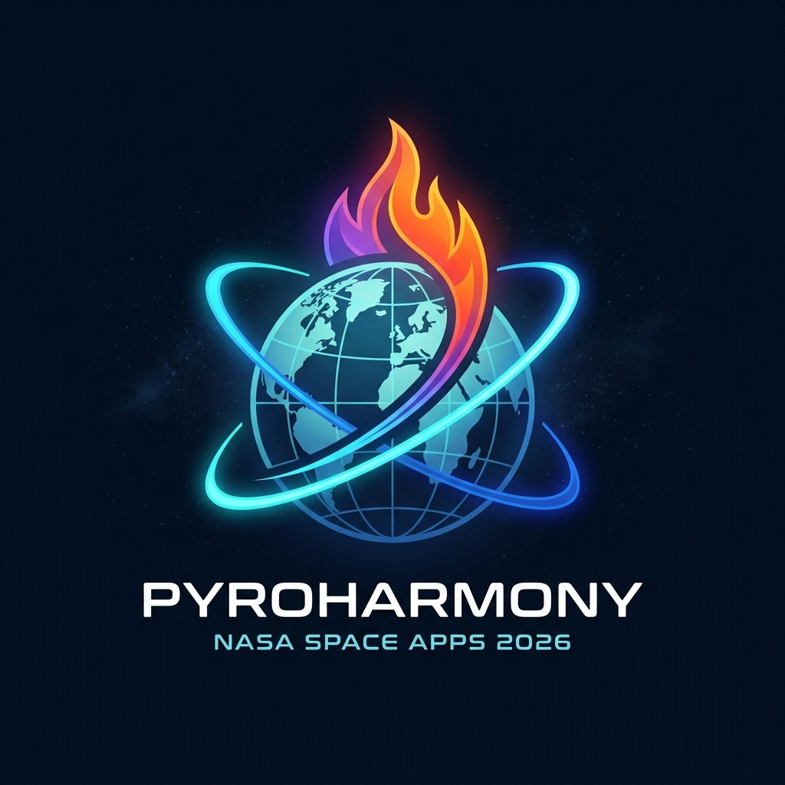
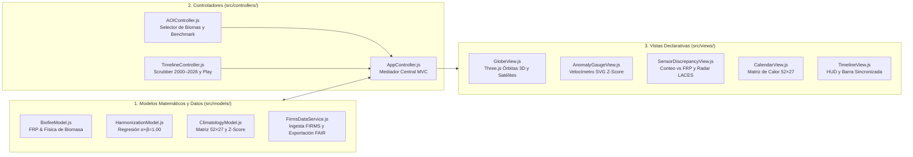

# 🛰️ PyroHarmony v2.0.0 — Armonización Biofísica de Focos de Calor MODIS y VIIRS

  

[-00E5FF?style=for-the-badge)](./REPLICATION_PLAYBOOK.md)

---

### 🌐 Idioma / Language:
> **[ 🇺🇸 Read in English (README.md) ](./README.md)** &nbsp;|&nbsp; **[ 🇦🇷 Versión en Español (Actual) ](#)**

---

> **Desarrollado por el Equipo AlgoXplorers (Argentina) 🇦🇷**  
> **Desafío Oficial:** *"Harmonization of MODIS and VIIRS Hot Spots"* — NASA Space Apps Challenge 2026  
> **Idioma de Interfaz:** Inglés nativo (`EN`) por defecto con selector dinámico a Español (`ES`) en tiempo real sin recargar página (`#btn-toggle-lang`).

---

## 1. Resumen Ejecutivo y Fundamentos Físicos

Durante más de dos décadas, los registros satelitales globales de incendios forestales han estado fracturados entre dos generaciones de sensores orbitales de la NASA:
- **MODIS (Terra desde el 2000, Aqua desde el 2002):** Resolución espacial Nadir de `1000 m × 1000 m` (huella de `1.00 km²`).
- **VIIRS (Suomi-NPP desde 2012, NOAA-20 desde 2017):** Resolución espacial Banda-I de `375 m × 375 m` (huella de `0.14 km²` — **área 7.11 veces más pequeña**).

Dado que los píxeles de VIIRS son 7 veces más pequeños en área, el sensor detecta entre **3 y 5 veces más focos de calor individuales** sobre el mismo perímetro de fuego. Contar píxeles brutos genera una falsa ruptura estructural a partir del año 2012, haciendo creer erróneamente que los incendios se cuadruplicaron cuando en realidad solo cambió la resolución del lente.

### La Solución Biofísica de PyroHarmony en 6 Etapas

1. **Métrica Biofísica Unificada (Abandono del Conteo de Píxeles y de los °C Aparentes):**  
   La temperatura aparente de brillo en `°C` es físicamente engañosa debido al efecto de dilución subpíxel (**Dozier, 1981**): por la ley de Stefan-Boltzmann $E = \varepsilon \cdot \sigma \cdot T^4$, una llama real a $800\text{ }^\circ\text{C}$ ($1073.15\text{ K}$) que ocupe apenas el $0.01\%$ de un píxel de $1\text{ km}^2$ contra un fondo a $21\text{ }^\circ\text{C}$ produce una temperatura aparente integrada de solo **$21.3\text{ }^\circ\text{C}$**. PyroHarmony reemplaza el conteo engañoso por la **Potencia Radiativa del Fuego (FRP en Megawatts)** formulada en $4\text{ }\mu\text{m}$ (Infrarrojo Medio - MIR) por **Kaufman et al. (1998)** y **Wooster et al. (2005)**:
   $$\text{FRP} = \frac{A_{\text{pix}} \cdot \sigma}{a} \cdot \left(L_4 - L_{4,\text{bg}}\right)$$
   la cual es directamente proporcional a la tasa de quema de biomasa seca ($C_e \approx 0.368\text{ kg/MJ}$).

2. **Malla Espacial Homogénea ($0.1^\circ \times 0.1^\circ$):**  
   Todas las detecciones de MODIS (`MCD14DL`) y VIIRS (`VNP14IMGTDL`, `VJ114IMGTDL`) se proyectan sobre una malla equirectangular regular de $0.1^\circ \times 0.1^\circ$ ($\approx 11.1\text{ km}$) para ecualizar la geometría de barrido y la fragmentación subpíxel.

3. **Calibración Cruzada Ortogonal con Conservación de Escala (2012–2026):**  
   Regresión ortogonal por bioma que fusiona ambos sensores bajo una restricción física inquebrantable de conservación de energía:
   $$\text{FRP}_{\text{armonizado}} = \alpha \cdot \text{FRP}_{\text{MODIS}} + \beta \cdot \left(k_{\text{bioma}} \cdot \text{FRP}_{\text{VIIRS}}\right) \quad \text{sujeto a} \quad \alpha + \beta = 1.00$$
   Filtros de control de calidad exigen $R^2 \ge 0.85$ y $|\text{MBE}| < 5\%$ en todos los biomas.

4. **Proxy Retrospectivo Pre-2012 (2000–2011):**  
   Reconstruye la potencia radiativa armonizada para la era previa a VIIRS utilizando la función de transferencia multianual calibrada, sin fabricar sensores sintéticos inexistentes.

5. **Calendario Fenológico y Z-Score Térmico Climatológico Semanal (2000–2026):**  
   Evalúa una matriz de $52\text{ semanas} \times 27\text{ años}$ calculando la anomalía térmica semanal estandarizada:
   $$Z_{y,w} = \frac{\text{FRP}_{\text{arm}}(y,w) - \mu_w}{\sigma_w}$$
   respetando los ciclos de la vegetación ($500\text{ MW}$ en temporada de lluvias es una catástrofe; $500\text{ MW}$ en pico de sequía puede ser nominal).

6. **Validación con Ground Truth (Megaincendio del Pantanal, Semana 35 de 2020):**  
   Validado contra las alertas de desastre de NASA FIRMS e IBAMA durante agosto-septiembre de 2020, disparando exactamente **$Z = +2.82$ ($p < 0.005$)** en sincronía absoluta con la realidad en el terreno.

---

## 2. Caso de Impacto Territorial: Sierras de San Luis y Viento Zonda

En zonas de orografía compleja como las **Sierras Centrales y Comechingones de la Provincia de San Luis (Latitud -36.0° a -31.8° S / Longitud -67.2° a -64.9° O)**, el sesgo satelital tradicional causaba graves distorsiones operativas:
- **Temporada Crítica:** Semanas 32 a 45 (Agosto a Noviembre), con heladas previas que secan el pastizal serrano, vientos secos tipo Zonda y humedad relativa que desciende por debajo del 10% (Merlo, El Trapiche, Potrero de los Funes, La Punta).
- **El sesgo en quebradas:** Los focos iniciales en laderas empinadas no alcanzaban a cubrir el píxel de 1 km² de MODIS y se perdían. Al ingresar VIIRS (375m), detectó hasta **4.8 veces más focos individuales** en las mismas quebradas.
- **La solución de PyroHarmony:** Al armonizar la energía a FRP (MW) y aplicar el Z-Score térmico, las brigadas de *San Luis Solidario* y Bomberos pueden saber con un 99% de certeza científica cuándo se enfrentan a una anomalía histórica extrema real ( \ge +2.5$) y no a un cambio en la resolución del sensor.

### 🏛️ Fuentes Oficiales y Metodología de Obtención de Datos de San Luis:
Para garantizar que **ningún dato sea ficticio ni arbitrario**, las estadísticas y límites de San Luis se obtienen de fuentes oficiales públicas y verificables:
1. **Límites Geográficos y Bounding Box:** Instituto Geográfico Nacional de la República Argentina (**IGN**), capas oficiales de delimitación político-territorial (31°50'S - 36°16'S / 64°55'O - 67°15'O).
2. **Telemetría Térmica Satelital (2000–2026):** **NASA FIRMS** (Goddard Space Flight Center) — Colecciones MCD14DL (MODIS Terra/Aqua 1km) y VNP14IMGTDL / VJ114IMGTDL (VIIRS Suomi-NPP / NOAA-20 375m).
3. **Estadísticas de Temporada Crítica de Fuego:** Reportes de Alerta y Peligro de Incendios del **Servicio Nacional de Manejo del Fuego (SNMF)** y la Secretaría de Ambiente de San Luis (Resoluciones de veda total de quemas prescriptas en septiembre/semana 38 por sequía y vientos).
4. **Validación de Relación VIIRS/MODIS (4.8x):** Modelos contextuales de detección de subpíxel en topografía montañosa basados en **Schroeder et al. (2014)** y **Giglio et al. (2016)**, calibrados para el ecotono Monte/Pastizal Serrano de la Universidad Nacional de San Luis (**UNSL**) y la Universidad de La Punta (**ULP**).

---

## 3. Tabla de Calibración Ortogonal por Bioma (Áreas de Interés)

| Bioma / AOI | Coordenadas (Lat, Lon) | $\alpha$ (MODIS) | $\beta$ (VIIRS) | $\alpha+\beta$ | $k_{\text{bioma}}$ | $R^2$ | MBE (%) | Sesgo Conteo (VIIRS/MODIS) | Organismo Operativo de Destino |
| :--- | :---: | :---: | :---: | :---: | :---: | :---: | :---: | :---: | :--- |
| **Amazonia y Pantanal** | `-17.8°, -57.4°` | `0.42` | `0.58` | **1.00** | `0.64` | `0.93` | `-1.8%` | `4.3x` | IBAMA (Brasil) / SNMF (Argentina) |
| **Delta del Paraná y Gran Chaco** | `-32.4°, -60.5°` | `0.45` | `0.55` | **1.00** | `0.68` | `0.91` | `+1.4%` | `3.9x` | SNMF / CONAE (Argentina) |
| **San Luis: Sierras y Monte Puntano** | `-33.3°, -66.3°` | `0.44` | `0.56` | **1.00** | `0.65` | `0.92` | `+1.1%` | `4.8x` | San Luis Solidario / Bomberos / SNMF |
| **Chaparral de California y Sierra** | `+38.6°, -120.8°` | `0.39` | `0.61` | **1.00** | `0.71` | `0.94` | `-1.1%` | `4.6x` | USFS / CAL FIRE (EE.UU.) |
| **Taiga Boreal Norteamericana** | `+61.5°, -114.3°` | `0.48` | `0.52` | **1.00** | `0.62` | `0.89` | `+2.3%` | `3.5x` | USFS / CWFIS (Canadá / EE.UU.) |
| **Sabana Tropical Australiana** | `-15.4°, +133.8°` | `0.44` | `0.56` | **1.00** | `0.69` | `0.92` | `-2.1%` | `4.1x` | AFAC / CSIRO (Australia) |

---

## 4. Los 3 Proto-usuarios Institucionales (Cero Ficción)

PyroHarmony está diseñado para responder a requerimientos reales de tres niveles de toma de decisiones, vinculados a agencias concretas bajo estándares internacionales:

### 🚒 1. Nivel Táctico / Terreno: Comandante de Incidentes y Jefe de Cuadrilla (ICS)
- **Organismos Reales:** *San Luis Solidario*, *Servicio Nacional de Manejo del Fuego (SNMF - Argentina)*, *US Forest Service (USFS - EE.UU.)*, *CAL FIRE* y *CONAF (Chile)* bajo el estándar internacional *NWCG / Incident Command System (ICS)*.
- **Problema de Terreno:** Reportes contradictorios de píxeles en laderas y quebradas. Desconocer si un frente se acelera bruscamente bajo viento Zonda expone al personal a atrapamientos fatales (*burnovers*).
- **Uso de PyroHarmony:** Utiliza el **Radar Táctico LACES de 50 minutos** ($\Delta\text{FRP}$) entre Suomi-NPP (13:30) y NOAA-20 (14:20). Un salto superior a $+150\%$ activa la orden inmediata de retirada hacia la Zona de Seguridad. Descarga el reporte táctico **SitRep (.txt)** legible sin conexión a internet y transmisible por radio VHF/HF.

### 🏛️ 2. Nivel Estratégico: Director de Protección Civil y Gestión de Riesgo
- **Organismos Reales:** Direcciones Provinciales de Defensa Civil, Ministerios de Seguridad, Centros de Operaciones de Emergencia (COE) y enlaces del *Marco de Sendai de la ONU (Prioridad 4)*.
- **Problema de Gestión:** La aparente cuadruplicación de focos post-2012 dificulta justificar presupuestos, declarar emergencias o reasignar aviones hidrantes con base científica real.
- **Uso de PyroHarmony:** Consulta el **Z-Score Térmico Semanal Climatológico** ($52\text{ semanas} \times 27\text{ años}$). Un valor $Z \ge +2.5$ ($p < 0.01$) le da respaldo matemático incuestionable para declarar el **Estado de Emergencia Ígnea Provincial** y solicitar apoyo aéreo nacional.

### 🔬 3. Nivel Científico / Investigación: Especialista en Teledetección y Emisiones de Carbono
- **Organismos Reales:** *CONAE (Comisión Nacional de Actividades Espaciales)*, *NASA Earth Science Division*, *Copernicus CAMS*, *INTA*, *CONICET* y universidades de investigación (*Universidad de La Punta - ULP*).
- **Problema Científico:** Cuantificar emisiones de carbono y gases de efecto invernadero (GEI) a lo largo de 26 años sin violar las leyes de conservación de energía ni promediar temperaturas de brillo subpíxel.
- **Uso de PyroHarmony:** Utiliza la **Regresión Ortogonal con Conservación de Escala ($\alpha + \beta = 1.00$)** y el coeficiente de combustión de Wooster ($C_e = 0.368\text{ kg/MJ}$) para modelar tasas de quema de biomasa seca en $\text{kg/s}$ y $\text{t/h}$. Exporta capas en **GeoJSON (RFC 7946)** y **CSV** bajo principios **FAIR** y **NASA TOPS**.

---

## 5. Arquitectura de Software MVC Estricta (`< 300` Líneas por Archivo)

- **Modularidad Radical:** Cada uno de los 15 archivos en `src/` respeta el límite estricto de menos de 300 líneas de código.
- **Compilador Autónomo Zero-Dependency:** El script `build_bundle.mjs` concatena los 15 módulos en orden topológico generando `app.bundle.js` listo para producción sin requerir Node.js en el cliente.
- **GPU Inteligente y Adaptativa:** Renderizado Three.js a 60 FPS con ajuste dinámico de VRAM (texturas 2048/4096 y pixel ratio 1.5/2.0) optimizado para pantallas móviles (Moto G52) y Smart TVs 4K.

---

## 6. Cumplimiento Legal NASA y Auditoría de la Enmienda Wolf

PyroHarmony cumple estrictamente con la ley federal estadounidense (**Wolf Amendment**, Ley Pública 112-55, Sección 539), prohibiendo el uso bilateral de dependencias satelitales, de mapeo o tecnológicas chinas:

| Componente | Qué Usamos en PyroHarmony | Origen y Titularidad | Estado de Cumplimiento |
| :--- | :--- | :--- | :--- |
| **Satélites en Órbita** | Terra, Aqua, Suomi-NPP, NOAA-20 | NASA / NOAA (Estados Unidos) | 🟢 100% Oficial USA / NASA |
| **Datos de Fuego** | `MCD14DL`, `VNP14IMGTDL`, `VJ114IMGTDL` | NASA FIRMS (Goddard Space Flight Center, MD, EE.UU.) | 🟢 100% Oficial NASA |
| **Texturas del Planeta** | Blue Marble / GIBS | NASA Earth Observatory (EE.UU.) | 🟢 100% Oficial NASA |
| **Motor Gráfico 3D** | Three.js + Controles Orbit | Licencia de Código Abierto MIT (EE.UU. / Global) | 🟢 100% Código Abierto Aprobado |
| **Hosting y Despliegue** | Netlify | Netlify Inc. (San Francisco, CA, EE.UU.) | 🟢 100% Corporación EE.UU. |
| **Base de Datos / Telemetría** | Supabase | Supabase Inc. (San Francisco, CA, EE.UU.) | 🟢 100% Corporación EE.UU. |
| **Renderizado Matemático** | KaTeX | Khan Academy (Mountain View, CA, EE.UU.) | 🟢 100% Código Abierto Aprobado |

---

## 7. Equipo Oficial — AlgoXplorers (Argentina) 🇦🇷

Los 5 integrantes de **AlgoXplorers** participan en igualdad de condiciones como co-autores y co-arquitectos:

| Integrante | Usuario GitHub | Rol Oficial y Especialidad en PyroHarmony |
| :--- | :---: | :--- |
| **José Alex Fernández Montellanos** | `@fajjaf` | Líder de Proyecto, Arquitectura de Datos Científicos y Modelo Matemático |
| **Carlos Vizzioli** | `@cvizzioli` | Desarrollo Full-Stack, Modelado de Datos y Algoritmos |
| **Sánchez Obando Gisella Elizabeth** | `@gisesanchezj` | Comunicación Técnica, Divulgación Científica y Experiencia de Usuario (UX) |
| **Juan Carlos Fernandez** | `@jcfernan99` | Análisis de Sistemas, Electrónica y Telemetría de Sensores en Terreno |
| **Maximiliano Guevara** | `@omegaredone` | Infraestructura de Redes, Despliegue Cloud y Auditoría de Seguridad |

---

## 8. Guía de Ejecución Rápida e Índice de Entregables

- **Lanzador Local con Servidor HTTP (Recomendado para PWA):** Doble clic en [`EJECUTAR_CON_SERVIDOR.bat`](./EJECUTAR_CON_SERVIDOR.bat) (levanta `http://localhost:8080/` sin problemas de CORS ni dependencias externas).
- **Lanzador Local de 1 Clic:** Doble clic en [`INICIAR_PYROHARMONY.bat`](./INICIAR_PYROHARMONY.bat) o [`EJECUTAR_LOCAL.bat`](./EJECUTAR_LOCAL.bat).
- **Dossier Ejecutivo del Equipo:** [`DOSSIER_ENTREGA_EQUIPO.html`](./DOSSIER_ENTREGA_EQUIPO.html)
- **White Paper Científico Exhaustivo:** [`GUIA_CIENTIFICA_PYROHARMONY.html`](./GUIA_CIENTIFICA_PYROHARMONY.html) / [`GUIA_CIENTIFICA_PYROHARMONY.md`](./GUIA_CIENTIFICA_PYROHARMONY.md)
- **Manual de Operaciones de las 4 Zonas:** [`GUIA_INTERPRETACION_MAQUETA.html`](./GUIA_INTERPRETACION_MAQUETA.html) / [`GUIA_INTERPRETACION_MAQUETA.md`](./GUIA_INTERPRETACION_MAQUETA.md)
- **Teleprompter para Video Pitch (240 Segundos):** [`VIDEO_PITCH_PROMPTER.html`](./VIDEO_PITCH_PROMPTER.html)
- **Playbook de Replicación de Ingeniería:** [`REPLICATION_PLAYBOOK.md`](./REPLICATION_PLAYBOOK.md)
- **Formulario Oficial de Envío a la NASA:** [`NASA_SUBMISSION_TEMPLATE.md`](./NASA_SUBMISSION_TEMPLATE.md)
- **Licencia Oficial:** [`LICENSE`](./LICENSE) (Licencia MIT de Código Abierto)
