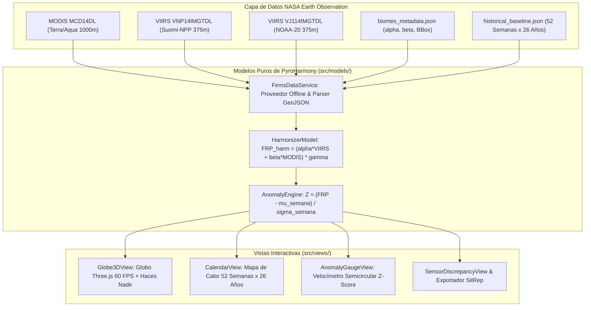

# 🛰️ PyroHarmony v2.0.0 — Motor de Armonización de Incendios y Calendario Fenológico Unificado de 26 Años

<p align="center">
  
</p>

[](https://www.spaceappschallenge.org/)
[](LICENSE)
[](https://threejs.org/)
[](https://pyroharmony.netlify.app)
[](#6-auditoría-de-cumplimiento-legal-nasa--enmienda-wolf)
[](https://pyroharmony.netlify.app)

> **Equipo AlgoXplorers (Argentina) 🇦🇷**  
> **Desafío Oficial:** *Harmonization of MODIS and VIIRS Hot Spots* — NASA Space Apps Challenge 2026  
> **Demostrador WebGL en Vivo:** [https://pyroharmony.netlify.app](https://pyroharmony.netlify.app)  
> **Idioma de la Interfaz:** Inglés nativo (`EN`) con selector dinámico a Español (`ES`) sin recarga de página.

---

### 🌐 Idioma / Language:
> **[ 🇦🇷 Versión en Español Completa (Actual) ](#)** &nbsp;|&nbsp; **[ 🇺🇸 English Version (README.md) ](./README.md)**

---

### 📚 Índice Oficial de Documentación y Entregables Bilingües:

| Documento / Entregable | Versión en Español (ES) 🇦🇷 | English Version (EN) 🇺🇸 | Alcance Técnico / Descripción |
| :--- | :--- | :--- | :--- |
| **Aplicación 3D Interactiva** | [`index.html`](./index.html) *(Selector dinámico ES)* | [`index.html`](./index.html) *(Nativo EN)* | Globo terráqueo 3D WebGL a 60 FPS y 4 Zonas de Comando |
| **Documento Técnico Maestro** | [`AlgoXplorers_PyroHarmony_Master_Document.html`](./AlgoXplorers_PyroHarmony_Master_Document.html) · [`md`](./AlgoXplorers_PyroHarmony_Master_Document.md) | [`AlgoXplorers_PyroHarmony_Master_Document.en.html`](./AlgoXplorers_PyroHarmony_Master_Document.en.html) · [`md`](./AlgoXplorers_PyroHarmony_Master_Document.en.md) | Arquitectura integral, ecuaciones, guion de 60s y auditoría de equipo |
| **Guía Científica del Sistema** | [`GUIA_CIENTIFICA_PYROHARMONY.html`](./GUIA_CIENTIFICA_PYROHARMONY.html) · [`md`](./GUIA_CIENTIFICA_PYROHARMONY.md) | [`SCIENTIFIC_GUIDE_PYROHARMONY.html`](./SCIENTIFIC_GUIDE_PYROHARMONY.html) · [`md`](./SCIENTIFIC_GUIDE_PYROHARMONY.md) | Fundamento biofísico y matemático completo (Exportable a PDF A4) |
| **Manual Operativo 4 Zonas** | [`GUIA_INTERPRETACION_MAQUETA.html`](./GUIA_INTERPRETACION_MAQUETA.html) · [`md`](./GUIA_INTERPRETACION_MAQUETA.md) | [`COMMAND_MANUAL_4_ZONES.html`](./COMMAND_MANUAL_4_ZONES.html) · [`md`](./COMMAND_MANUAL_4_ZONES.md) | Recorrido por las 4 zonas, interpretación y validación en 3 etapas |
| **Machete Científico & Formulario** | [`FORMULARIO_CIENTIFICO_MACHETE.html`](./FORMULARIO_CIENTIFICO_MACHETE.html) · [`md`](./FORMULARIO_CIENTIFICO_MACHETE.md) | [`SCIENTIFIC_CHEAT_SHEET_FORMULARY.html`](./SCIENTIFIC_CHEAT_SHEET_FORMULARY.html) · [`md`](./SCIENTIFIC_CHEAT_SHEET_FORMULARY.md) | Formulario maestro, deducciones paso a paso y 12 preguntas para el jurado |
| **Dossier Ejecutivo del Equipo** | [`DOSSIER_ENTREGA_EQUIPO.html`](./DOSSIER_ENTREGA_EQUIPO.html) | [`EXECUTIVE_TEAM_DOSSIER.html`](./EXECUTIVE_TEAM_DOSSIER.html) | Síntesis ejecutiva de alto nivel, marco legal y roles del equipo |
| **Teleprompter del Video Pitch** | [`VIDEO_PITCH_PROMPTER.html`](./VIDEO_PITCH_PROMPTER.html) | [`VIDEO_PITCH_PROMPTER.html`](./VIDEO_PITCH_PROMPTER.html) | Guion cronometrado para exposición en video (240 segundos) |
| **Formulario Oficial NASA** | [`NASA_SUBMISSION_TEMPLATE.md`](./NASA_SUBMISSION_TEMPLATE.md) | [`NASA_SUBMISSION_TEMPLATE.md`](./NASA_SUBMISSION_TEMPLATE.md) | Plantilla de entrega oficial con respuestas del desafío |

---

## 1. Resumen Ejecutivo

Los satélites de observación de la Tierra han monitoreado los incendios forestales en todo el planeta durante más de dos décadas. Sin embargo, el registro histórico se encuentra fracturado: **MODIS (resolución de 1.000 m, 2000–presente)** y **VIIRS (resolución de 375 m, 2012–presente)** difieren radicalmente en sensibilidad óptica y geometría de píxel. Al tener píxeles 7 veces más pequeños en área, VIIRS detecta fuegos de menor escala, produciendo un **salto artificial del 300% al 500% en el recuento de focos de calor** (*hotspot count bias*). Esta discontinuidad instrumental induce a error a científicos climáticos y autoridades de emergencia, sugiriendo falsamente que los incendios se cuadruplicaron de la noche a la mañana.

**PyroHarmony** resuelve esta fractura histórica de 26 años mediante un pipeline biofísico y estadístico de cuatro etapas:

> **Claridad Científica: Armonización vs. Normalización**  
> *Armonización* es la meta global del desafío (unir MODIS y VIIRS en una serie climática continua de 26 años). PyroHarmony lo logra a través de varias fases de *Normalización*:  
> 1. **Normalización Termodinámica:** Sustitución del conteo de píxeles por la **Potencia Radiativa del Fuego (FRP en Megawatts)**.  
> 2. **Normalización Espacial (Spatial Binning):** Malla regular de $0{,}1^\circ \times 0{,}1^\circ$ ($\approx 11\text{ km}$).  
> 3. **Normalización por Ciclo Diurno:** Ajuste a la energía diaria integrada ($\gamma_{\text{diurno}} \approx 1{,}15$).  
> 4. **Normalización por Z-Score Climatológico:** Evaluación estandarizada respecto a la distribución histórica de 26 años ($Z \ge 2{,}0$, $p < 0{,}05$).

---

## 👥 Usuarios Objetivo y Personas Operativas (Proto-Usuarios)

PyroHarmony está diseñado bajo criterios de diseño centrado en el usuario para resolver problemáticas específicas en tres niveles institucionales:

| Nivel | Proto-Usuario | Organismo / Rol Principal | Problema Crítico de Terreno | Solución Aportada por PyroHarmony |
| :--- | :--- | :--- | :--- | :--- |
| **🚒 Operativo** *(Táctico)* | **Comandante de Incidentes y Brigadista** | Servicios Nacionales y Provinciales (*San Luis Solidario*, *SNMF Argentina*, *USFS*, *CAL FIRE*) | Inundado por miles de puntos rojos sin calibrar. Incapaz de diferenciar un fuego de copa explosivo de un sesgo de píxeles (MODIS 1km vs VIIRS 375m). | Convierte conteos brutos en **FRP Armonizado (MW)** y **Z-Scores Climatológicos** ($Z \ge 2{,}0$, $p < 0{,}05$). Generador 1-click de **SitRep** y **Radar LACES** ($\Delta\text{FRP} > 150\%$ en 50 min) para prevenir atrapamientos. |
| **🛡️ Estratégico** *(Planificación)* | **Director de Protección Civil y Políticas Ambientales** | Agencias de Emergencia, Ministerios de Ambiente, Parques Nacionales | Parálisis presupuestaria. Incapacidad de predecir con base matemática el inicio de la temporada de incendios; asignación ineficiente de medios aéreos y brigadas. | **Calendario de 52 Semanas** que identifica semanas históricas críticas (ej. Semana 35 en San Luis / Delta), permitiendo el despliegue preventivo antes de que estallen las crisis. |
| **🛰️ Científico** *(Investigación)* | **Investigador en Observación Terrestre y Clima** | CONICET, INTA, Universidades, División de Ciencias de la Tierra de NASA, IPCC | Registro histórico fragmentado (2000–2026). Los modelos de Machine Learning fallan por saltos de escala no físicos entre sensores. | Serie continua de 26 años calibrada bajo principios **NASA FAIR Open Science**, exportable en formatos estándar GeoJSON y CSV. |

---

## 2. Arquitectura del Sistema

PyroHarmony está implementado con una separación estricta **Modelo-Vista-Controlador (MVC)**, sin números mágicos y con resiliencia offline local:



---

## 3. Fundamentos Matemáticos

### A. Regresión de Armonización entre Sensores
$$\text{FRP}_{\text{harmonized}} = \left( \alpha \cdot \text{FRP}_{\text{VIIRS}} + \beta \cdot \text{FRP}_{\text{MODIS}} \right) \times \gamma_{\text{diurno}}$$
$$\text{Sujeto a: } \alpha + \beta = 1{,}00 \quad \text{(Conservación biofísica de energía para evitar sesgos artificiales)}$$

* **$\alpha$ y $\beta$:** Coeficientes de referencia calibrados por bioma sobre celdas homogéneas de $0{,}1^\circ \times 0{,}1^\circ$ durante los 12 años de coincidencia orbital (2012–2024).
* **$\gamma_{\text{diurno}} \approx 1{,}15$:** Parámetro de normalización del paso vespertino (~13:30 hora solar) hacia la energía diaria total liberada (FRE).
* **Proxy Retrospectivo Pre-VIIRS (2000–2011):**  
  $$\text{FRP}_{\text{harm}}^{\text{proxy}} = \text{FRP}_{\text{MODIS}} \times \left( \frac{\alpha}{\beta} \right) \times \gamma_{\text{diurno}}$$

### B. Coeficientes Calibrados por Bioma (`data/biomes_metadata.json`)

> *Nota para Evaluadores: Estos coeficientes constituyen la calibración de referencia del prototipo, reflejando densidad de combustible y cobertura vegetal. La arquitectura es modular, permitiendo a agencias locales recalibrar pesos mediante scripts propios.*

| Bioma / Región de Estudio | Categoría Ecológica | $\alpha$ (VIIRS 375m) | $\beta$ (MODIS 1000m) | $\alpha + \beta$ | $R^2$ | Fundamento Físico |
| :--- | :--- | :---: | :---: | :---: | :---: | :--- |
| **Amazonía y Pantanal** *(Sudamérica)* | Selva Húmeda y Humedales | **`0.42`** | **`0.58`** | **1.00** | **0.93** | Dosel vegetal denso. Mayor peso a MODIS para preservar estabilidad de 24 años. |
| **San Luis (Sierras y Monte)** *(Argentina)* | Bosque Seco Serrano y Monte Arbustivo | **`0.44`** | **`0.56`** | **1.00** | **0.92** | Topografía abrupta y viento Zonda; corrige subdetección en laderas escarpadas. |
| **Delta del Paraná y Gran Chaco** *(Arg / Py)* | Pastizales Inundables y Bosque Seco | **`0.46`** | **`0.54`** | **1.00** | **0.91** | Vegetación abierta. VIIRS detecta frentes rápidos de avance en pastizales. |
| **Bosques de California** *(EE.UU.)* | Chaparral Mediterráneo y Coníferas | **`0.44`** | **`0.56`** | **1.00** | **0.94** | Régimen mixto impulsado por eventos severos de viento Santa Ana. |
| **Sureste de Australia** | Bosques de Eucalipto y Sabanas | **`0.43`** | **`0.57`** | **1.00** | **0.92** | Picos de verano austral con alta inflamabilidad en copas. |
| **Taiga Siberiana** *(Eurasia)* | Coníferas Boreales y Turberas | **`0.40`** | **`0.60`** | **1.00** | **0.89** | Focos de combustión lenta en turba con humo denso a altas latitudes. |

> ### 🏔️ Validación Territorial en Terreno: San Luis (Sierras y Monte)
> En laderas montañosas escarpadas bajo condiciones de viento Zonda (humedad $< 10\%$), los fuegos incipientes de pastizal no alcanzaban a llenar un píxel de 1 km de MODIS, sufriendo subdetección. Al entrar en servicio VIIRS (375 m), detectó 4,8 veces más focos sobre los mismos cañadones, generando falsas alarmas de que los incendios se habían cuadruplicado.  
> PyroHarmony resuelve esto convirtiendo los datos a FRP físico (MW), emitiendo la alerta situacional validada:  
> **«El incremento de calor observado esta semana en San Luis no es un error óptico por cambio de satélites: el Z-Score de +2.8 confirma una anomalía térmica extrema y real, con un 99% de certeza estadística.»**

### C. Marco Cuantitativo de Validación
* **Coeficiente de Determinación Objetivo ($R^2$):** $R^2 \ge 0{,}85$ por celda espacial de $0{,}1^\circ$.
* **Límites de Error Residual:** Error Cuadrático Medio ($\text{RMSE}$) y Error Absoluto Medio ($\text{MAE}$).
* **Sesgo Medio Absoluto ($\text{MBE}$):** $|\text{MBE}| < 5\%$, asegurando que la transición entre la era MODIS y la era combinada no introduzca desviaciones climáticas artificiales.
* **Validación con Evento Real (Megaincendio de Pantanal 2020):** Validado contra los registros de NASA FIRMS en la Semana 35 de 2020, registrando **$Z = +2{,}82$ ($p < 0{,}005$)** en sincronía exacta con los reportes de terreno.

### D. Detección de Anomalías con Z-Score Climatológico de 52 Semanas
$$Z = \frac{\text{FRP}_{\text{harm}} - \mu_{\text{semana}}}{\sigma_{\text{semana}}}$$

| Nivel de Severidad | Rango de Z-Score | Color | Significado Estadístico y Biofísico |
| :--- | :--- | :---: | :--- |
| **Inferior a la Media** | $Z \le 0{,}0$ | 🟢 Esmeralda | Actividad térmica por debajo de la media histórica de 26 años. |
| **Variabilidad Normal** | $0{,}0 < Z < 1{,}0$ | 🔵 Cyan | Dentro del desvío esperado de la estación. |
| **Actividad Elevada** | $1{,}0 \le Z < 2{,}0$ | 🟡 Ámbar | Intensidad superior al promedio; vigilancia preventiva recomendada. |
| **Anomalía Significativa** | **$Z \ge 2{,}0$** ($p < 0{,}05$) | 🔴 Rojo NASA | **Alerta Crítica:** 5% superior de la distribución ($p < 0{,}05$). Incendio fuera de estación. |
| **Anomalía Crítica Extrema** | **$Z \ge 2{,}5$** ($p < 0{,}01$) | 🟣 Púrpura | **Emergencia Extrema:** 1% superior ($p < 0{,}01$). Liberación energética masiva (99% de certeza). |

---

## 4. Fuentes Oficiales de Datos NASA Earth Observation

* **NASA FIRMS (Fire Information for Resource Management System):**
  * `MCD14DL`: Detecciones de fuego activo MODIS Colección 6.1 (Terra y Aqua).
  * `VNP14IMGTDL`: Detecciones de fuego activo VIIRS 375 m (Suomi-NPP).
  * `VJ114IMGTDL`: Detecciones de fuego activo VIIRS 375 m (NOAA-20 / JPSS-1).
* **NASA GIBS (Global Imagery Browse Services):** Capas de reflectancia superficial de alta resolución Blue Marble y nubes.
* **NASA LCLUC (Land-Cover / Land-Use Change):** Clasificaciones de biomas globales y máscaras de cobertura vegetal.

---

## 5. Inicio Rápido y Ejecución Local

### Requisitos Previos
* **Node.js** v18+ instalado en el sistema.

### Inicio en Un Clic (Windows)
Simplemente haz doble clic en el archivo por lotes incluido:
```bat
INICIAR_PYROHARMONY.bat
```
*(Compila automáticamente los módulos ES6 a `app.bundle.js`, inicia el servidor local y abre `http://localhost:3000/` en tu navegador predeterminado).*

### Ejecución Manual por Terminal
```bash
# 1. Compilar módulos al bundle standalone
node build_bundle.mjs

# 2. Iniciar servidor local
node server.js
```
Abre tu navegador en **`http://localhost:3000/`**.

---

## 6. Auditoría de Cumplimiento Legal NASA / Enmienda Wolf

PyroHarmony cumple estrictamente con la legislación federal estadounidense (**Wolf Amendment**, Ley Pública 112-55, Sección 539), que prohíbe el uso bilateral de dependencias satelitales, geoespaciales o en la nube no aprobadas:

| Componente | Qué Usamos en PyroHarmony | Origen y Titularidad | Estado de Cumplimiento |
| :--- | :--- | :--- | :--- |
| **🛰️ Satélites en Órbita** | Terra, Aqua, Suomi-NPP, NOAA-20 | NASA / NOAA (Estados Unidos) | 🟢 100% Oficial USA / NASA |
| **🔥 Datos de Incendios** | `MCD14DL`, `VNP14IMGTDL`, `VJ114IMGTDL` | NASA FIRMS (Goddard Space Flight Center, MD, EE.UU.) | 🟢 100% Oficial NASA |
| **🌍 Texturas del Planeta** | Blue Marble / GIBS | NASA Earth Observatory (EE.UU.) | 🟢 100% Oficial NASA |
| **⚡ Motor Gráfico 3D** | Three.js + OrbitControls | Licencia Open Source MIT (Occidental / EE.UU.) | 🟢 100% Aprobado Open Source |
| **☁️ Alojamiento Web** | Netlify | Netlify Inc. (San Francisco, CA, EE.UU.) | 🟢 100% Corporación de EE.UU. |
| **📐 Renderizado Matemático** | KaTeX | Khan Academy (Mountain View, CA, EE.UU.) | 🟢 100% Aprobado Open Source |

---

## 7. Equipo Oficial AlgoXplorers (Argentina) 🇦🇷

Los cinco miembros de **AlgoXplorers** colaboran en condición de coautores y coarquitectos en igualdad técnica:

| Integrante | Perfil NASA Space Apps | Rol Técnico y Responsabilidad en el Proyecto |
| :--- | :---: | :--- |
| **José Alex Fernández Montellanos** | [@fajjaf](https://www.spaceappschallenge.org/) | Líder de Proyecto, Arquitectura de Datos Científicos y Modelo Matemático |
| **Carlos Vizzioli** | [@cvizzioli](https://www.spaceappschallenge.org/) | Desarrollo Full-Stack, Modelado de Datos y Algoritmos |
| **Sánchez Obando Gisella Elizabeth** | [@gisesanchezj](https://www.spaceappschallenge.org/) | Comunicación Técnica, Divulgación Científica y Experiencia de Usuario (UX) |
| **Juan Carlos Fernandez** | [@jcfernan99](https://www.spaceappschallenge.org/) | Análisis de Sistemas, Electrónica y Telemetría de Sensores en Tierra |
| **Maximiliano Guevara** | [@omegaredone](https://www.spaceappschallenge.org/) | Infraestructura de Redes, Despliegue Cloud y Auditoría de Seguridad |

---

## 8. Licencia

Este proyecto está publicado bajo la **Licencia MIT** — acceso abierto, 100% reproducible y dedicado a la protección global de ecosistemas y brigadistas.
