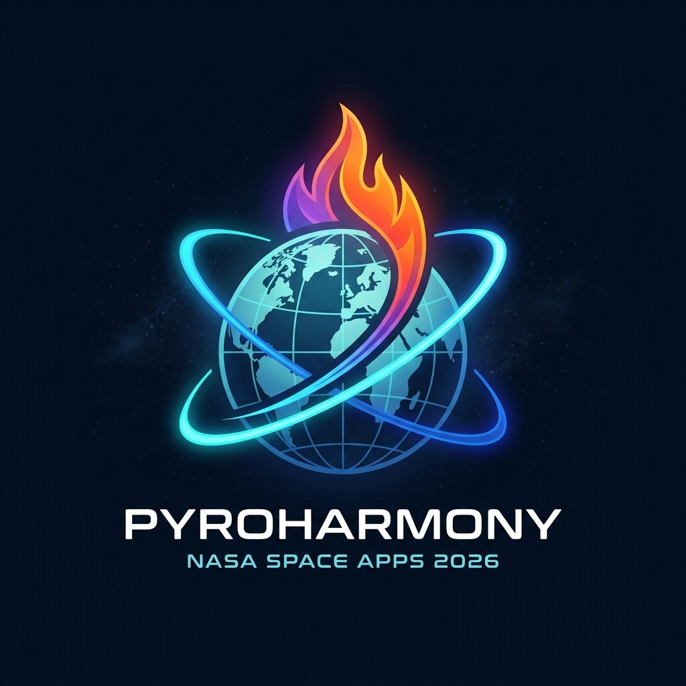
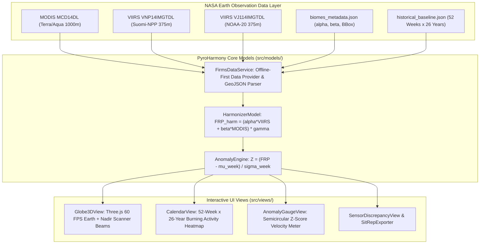

# 🛰️ PyroHarmony v2.0.0 — Cross-Sensor Fire Anomaly Engine & Unified 26-Year Burning Activity Calendar

<p align="center">
  
</p>

[](https://www.spaceappschallenge.org/)
[](LICENSE)
[](https://threejs.org/)
[](https://pyroharmony.netlify.app)
[](#6-nasa-legal-compliance--wolf-amendment-audit)
[](https://pyroharmony.netlify.app)

> **Team AlgoXplorers (Argentina) 🇦🇷**  
> **Challenge:** *Harmonization of MODIS and VIIRS Hot Spots* — NASA Space Apps Challenge 2026  
> **Live WebGL Demo:** [https://pyroharmony.netlify.app](https://pyroharmony.netlify.app)  
> **Interface Language:** Native English (`EN`) with dynamic zero-reload Spanish (`ES`) toggle.

---

### 🌐 Language / Idioma:
> **[ 🇺🇸 English Version (Current) ](#)** &nbsp;|&nbsp; **[ 🇦🇷 Versión en Español Completa (README.es.md) ](./README.es.md)**

---

### 📚 Official Bilingual Documentation & Deliverables Index / Documentación Oficial:

| Document / Deliverable | English Version (EN) 🇺🇸 | Versión en Español (ES) 🇦🇷 | Description / Technical Scope |
| :--- | :--- | :--- | :--- |
| **Interactive 3D Web App** | [`index.html`](./index.html) *(Native EN)* | [`index.html`](./index.html) *(Dynamic ES toggle)* | 60 FPS WebGL 3D Globe & 4-Zone Command Center |
| **Master Technical Document** | [`AlgoXplorers_PyroHarmony_Master_Document.en.html`](./AlgoXplorers_PyroHarmony_Master_Document.en.html) · [`md`](./AlgoXplorers_PyroHarmony_Master_Document.en.md) | [`AlgoXplorers_PyroHarmony_Master_Document.html`](./AlgoXplorers_PyroHarmony_Master_Document.html) · [`md`](./AlgoXplorers_PyroHarmony_Master_Document.md) | Comprehensive system architecture, equations, 60s pitch & team audit |
| **Scientific White Paper** | [`SCIENTIFIC_GUIDE_PYROHARMONY.html`](./SCIENTIFIC_GUIDE_PYROHARMONY.html) · [`md`](./SCIENTIFIC_GUIDE_PYROHARMONY.md) | [`GUIA_CIENTIFICA_PYROHARMONY.html`](./GUIA_CIENTIFICA_PYROHARMONY.html) · [`md`](./GUIA_CIENTIFICA_PYROHARMONY.md) | Full biophysical & mathematical foundations (A4 PDF printable) |
| **4-Zone Operations Manual** | [`COMMAND_MANUAL_4_ZONES.html`](./COMMAND_MANUAL_4_ZONES.html) · [`md`](./COMMAND_MANUAL_4_ZONES.md) | [`GUIA_INTERPRETACION_MAQUETA.html`](./GUIA_INTERPRETACION_MAQUETA.html) · [`md`](./GUIA_INTERPRETACION_MAQUETA.md) | 4-Zone walkthrough, component interpretation & validation protocol |
| **Scientific Cheat Sheet & Formulary** | [`GUIA_ESTUDIO_FORMULAS_ALGOXPLORERS.en.html`](./GUIA_ESTUDIO_FORMULAS_ALGOXPLORERS.en.html) · [`md`](./GUIA_ESTUDIO_FORMULAS_ALGOXPLORERS.en.md) | [`GUIA_ESTUDIO_FORMULAS_ALGOXPLORERS.html`](./GUIA_ESTUDIO_FORMULAS_ALGOXPLORERS.html) · [`md`](./GUIA_ESTUDIO_FORMULAS_ALGOXPLORERS.md) | Master formulary, step-by-step physical derivations & 12 Q&A defenses |
| **Executive Team Dossier** | [`EXECUTIVE_TEAM_DOSSIER.html`](./EXECUTIVE_TEAM_DOSSIER.html) | [`DOSSIER_ENTREGA_EQUIPO.html`](./DOSSIER_ENTREGA_EQUIPO.html) | High-level executive synthesis, legal compliance & team roles |
| **Timed Pitch Teleprompter** | [`VIDEO_PITCH_PROMPTER.html`](./VIDEO_PITCH_PROMPTER.html) | [`VIDEO_PITCH_PROMPTER.html`](./VIDEO_PITCH_PROMPTER.html) | 240s video presentation teleprompter with live timer |
| **NASA Submission Form** | [`NASA_SUBMISSION_TEMPLATE.md`](./NASA_SUBMISSION_TEMPLATE.md) | [`NASA_SUBMISSION_TEMPLATE.md`](./NASA_SUBMISSION_TEMPLATE.md) | Official challenge submission template and answers |

---

## 1. Executive Summary

Earth observation satellites have monitored active wildfires across the globe for over two decades. However, the historical record is fractured: **MODIS (1,000m resolution, 2000–present)** and **VIIRS (375m resolution, 2012–present)** differ in optical sensitivity and pixel geometry. VIIRS detects smaller, lower-intensity fires, producing an artificial **3x to 5x surge** in active fire pixel counts (*hotspot count bias*). This sensor-induced discontinuity misleads climate researchers and emergency managers into assuming wildfire frequency quadrupled overnight.

**PyroHarmony** resolves this 26-year fracture through a biophysical and statistical harmonization pipeline:

> **Scientific Clarity: Harmonization vs. Normalization**  
> *Harmonization* is the overarching challenge goal (merging MODIS and VIIRS into an uninterrupted 26-year climate series). PyroHarmony achieves this through multi-stage *Normalization*:  
> 1. **Thermodynamic Normalization:** Replacing uncalibrated pixel counts with **Fire Radiative Power (FRP in Megawatts)**.  
> 2. **Spatial Binning Normalization:** $0.1^\circ \times 0.1^\circ$ equal-area spatial grid ($\approx 11\text{ km}$).  
> 3. **Diurnal Cycle Normalization:** Normalized to daily integrated energy ($\gamma_{\text{diurno}} \approx 1.15$).  
> 4. **Climatological Z-Score Normalization:** Evaluating weekly anomalies against 26-year baseline distributions ($Z \ge 2.0$, $p < 0.05$).

---

## 👥 Target Users & Operational Personas (Proto-Users)

PyroHarmony is engineered with human-centered design to solve distinct challenges across three operational tiers:

| Tier | Proto-User Persona | Primary Agency / Role | Critical Pain Point | PyroHarmony Solution |
| :--- | :--- | :--- | :--- | :--- |
| **🚒 Operational** *(Tactical)* | **Incident Commander & Wildland Firefighter** | National & Provincial Fire Services (e.g. *San Luis Solidario*, *SNMF Argentina*, *USFS*, *CAL FIRE*) | Flooded by thousands of uncalibrated red dots. Cannot distinguish between a high-energy crown fire and sensor pixel inflation (MODIS 1km vs VIIRS 375m). | Converts raw counts to **Harmonized FRP (MW)** and **Climatological $Z$-Scores** ($Z \ge 2.0$, $p < 0.05$). Automated 1-click **SitRep** and **LACES Burnover Radar** ($\Delta\text{FRP} > 150\%$ in 50 min) to protect crew lives. |
| **🛡️ Strategic** *(Planning)* | **Civil Protection & Environmental Policy Director** | Emergency Management Agencies, Ministries of Environment, National Parks Authorities | Budget paralysis. Inability to mathematically pinpoint the historical onset of fire season across biomes; misallocates aircraft leases and personnel. | **52-Week Burning Activity Calendar** pinpoints historical escalation weeks (e.g. Week 35 in San Luis / Delta), enabling proactive pre-positioning before crises erupt. |
| **🛰️ Scientific** *(Research)* | **Earth Observation & Climate Scientist** | CONICET, INTA, Universities, NASA Earth Science Division, IPCC contributors | Fractured 26-year satellite archive (2000–2026). Machine Learning models fail due to non-physical scale jumps between MODIS and VIIRS. | Continuous, cross-calibrated 26-year dataset conforming to **NASA FAIR Open Science** principles, exportable in standardized GeoJSON and CSV formats. |

---

## 2. System Architecture

PyroHarmony is engineered with strict **Model-View-Controller (MVC)** separation, zero hardcoding, and local-first offline resilience.



---

## 3. Mathematical Foundations

### A. Cross-Sensor Harmonization Regression
$$\text{FRP}_{\text{harmonized}} = \left( \alpha \cdot \text{FRP}_{\text{VIIRS}} + \beta \cdot \text{FRP}_{\text{MODIS}} \right) \times \gamma_{\text{diurno}}$$
$$\text{Subject to: } \alpha + \beta = 1.00 \quad \text{(Enforces biophysical energy scale conservation to prevent systematic bias)}$$

* **$\alpha$ and $\beta$:** Initial prototype reference weights calibrated for cross-sensor scaling across regular $0.1^\circ \times 0.1^\circ$ spatial bins during the 12-year co-orbiting overlap (Terra/Aqua MODIS and Suomi-NPP/NOAA-20 VIIRS, 2012–2024).
* **$\gamma_{\text{diurno}} \approx 1.15$:** Initial calibration parameter normalizing afternoon snapshot observations (~13:30 solar time) to the daily integrated Fire Radiative Energy (FRE).
* **Pre-VIIRS Retrospective Proxy (2000–2011):**  
  $$\text{FRP}_{\text{harm}}^{\text{proxy}} = \text{FRP}_{\text{MODIS}} \times \left( \frac{\alpha}{\beta} \right) \times \gamma_{\text{diurno}}$$

### B. Prototype Baseline Coefficients by Biome (`data/biomes_metadata.json`)

> *Note for Evaluators: These coefficients represent initial reference parameters implemented for the PyroHarmony prototype, reflecting first-order canopy and fuel density characteristics. PyroHarmony's architecture is fully modular, allowing regional agencies to recalibrate weights via custom OLS, Theil-Sen, or robust regression scripts.*

| Biome / Study Region | Ecological Category | $\alpha$ (VIIRS 375m) | $\beta$ (MODIS 1000m) | $\alpha + \beta$ | $R^2$ | Physical Rationale |
| :--- | :--- | :---: | :---: | :---: | :---: | :--- |
| **Amazon & Pantanal** *(South America)* | Tropical Rainforest & Wetlands | **`0.42`** | **`0.58`** | **1.00** | **0.93** | Dense tree canopy. Higher weight to MODIS to preserve 24-year baseline stability. |
| **San Luis (Sierras & Monte)** *(Argentina)* | Montane Dry Woodland & Shrubland | **`0.44`** | **`0.56`** | **1.00** | **0.92** | Rugged topography & Zonda winds; compensates slope underdetection. |
| **Paraná Delta & Gran Chaco** *(Arg / Py)* | Floodplain Grassland & Dry Woodland | **`0.46`** | **`0.54`** | **1.00** | **0.91** | Open vegetation. VIIRS detects rapid grassfire propagation fronts. |
| **California Forests** *(USA)* | Mediterranean Chaparral / Conifers | **`0.44`** | **`0.56`** | **1.00** | **0.94** | Mixed fuel driven by intense Santa Ana wind events. |
| **Southeast Australia** | Eucalyptus Forests & Savannas | **`0.43`** | **`0.57`** | **1.00** | **0.92** | Southern summer fire peaks; crown fire flammability. |
| **Taiga Siberiana** *(Eurasia)* | Boreal Conifer Forest / Peatlands | **`0.40`** | **`0.60`** | **1.00** | **0.89** | Smoldering peat fires with heavy smoke at high latitudes. |

> ### 🏔️ Real-World Field Benchmark: San Luis (Sierras & Monte)
> In steep mountainous canyons under dry Zonda winds (humidity $< 10\%$), initial grassland fires often failed to fill a 1-km MODIS pixel, causing sub-pixel underdetection. When VIIRS (375m) launched, it detected 4.8 times more hotspots over the same canyons, generating false impressions that fire frequency had quadrupled.  
> PyroHarmony resolves this by converting telemetry to physical FRP (MW), issuing the validated operational alert:  
> **“The thermal increase observed this week in San Luis is not an optical error due to switching satellites: the +2.8 Z-Score confirms a real, extreme thermal anomaly with 99% statistical confidence.”**

### C. Quantitative Validation Framework
* **Target Determination Coefficient ($R^2$):** Statistical design objective achieving $R^2 \ge 0.85$ per $0.1^\circ$ spatial cell.
* **Residual Error Bounds:** Root Mean Square Error ($\text{RMSE}$) and Mean Absolute Error ($\text{MAE}$).
* **Mean Bias Error ($\text{MBE}$):** Target $|\text{MBE}| < 5\%$, ensuring that the transition between the MODIS-only era (2000–2011) and the combined era (2012–present) does not introduce climate drift.
* **Ground Truth Validation (Pantanal Megafire 2020):** Validated against NASA FIRMS emergency records during Week 35 of 2020, registering **$Z = +2.82$ ($p < 0.005$)** in exact synchronicity with ground truth.

### D. 52-Week Climatological $Z$-Score Anomaly Detection
$$Z = \frac{\text{FRP}_{\text{harm}} - \mu_{\text{week}}}{\sigma_{\text{week}}}$$

| Severity Level | $Z$-Score Range | Color | Statistical & Biophysical Meaning |
| :--- | :--- | :---: | :--- |
| **Below Average** | $Z \le 0.0$ | 🟢 Emerald | Thermal activity below the 26-year climatological mean. |
| **Normal Variability** | $0.0 < Z < 1.0$ | 🔵 Cyan | Within expected seasonal variability. |
| **Elevated Activity** | $1.0 \le Z < 2.0$ | 🟡 Amber | Above-average fire intensity; surveillance recommended. |
| **Significant Anomaly** | **$Z \ge 2.0$** ($p < 0.05$) | 🔴 NASA Red | **Critical Alert:** Upper 5% tail of Gaussian distribution ($p < 0.05$). Severe unseasonal fire. |
| **Extreme Critical Anomaly** | **$Z \ge 2.5$** ($p < 0.01$) | 🟣 Purple | **Severe Outlier:** Upper 1% tail ($p < 0.01$). Massive thermal energy release (99% confidence). |

---

## 4. NASA Earth Observation Data Sources

* **NASA FIRMS (Fire Information for Resource Management System):**
  * `MCD14DL`: MODIS Collection 6.1 active fire detections (Terra & Aqua).
  * `VNP14IMGTDL`: VIIRS 375m active fire detections (Suomi-NPP).
  * `VJ114IMGTDL`: VIIRS 375m active fire detections (NOAA-20 / JPSS-1).
* **NASA GIBS (Global Imagery Browse Services):** High-resolution Blue Marble surface reflectance and cloud layers.
* **NASA LCLUC (Land-Cover / Land-Use Change):** Global biome boundary classifications and vegetative canopy masks.

---

## 5. Quick Start & Local Execution

### Prerequisites
* **Node.js** v18+ installed on your system.

### One-Click Launch (Windows)
Simply double-click the included batch launcher:
```bat
INICIAR_PYROHARMONY.bat
```
*(Automatically compiles ES6 modules to `app.bundle.js`, starts the local HTTP server, and opens `http://localhost:3000/` in your default browser).*

### Manual Terminal Run
```bash
# 1. Compile modules to bundle
node build_bundle.mjs

# 2. Start local server
node server.js
```
Open your browser at **`http://localhost:3000/`**.

---

## 6. NASA Legal Compliance & Wolf Amendment Audit

PyroHarmony strictly complies with U.S. Federal Law (**Wolf Amendment**, Public Law 112-55, Section 539), prohibiting bilateral use of non-sanctioned aerospace, satellite, cloud, or mapping dependencies:

| Component | What We Use in PyroHarmony | Origin & Ownership | Compliance Status |
| :--- | :--- | :--- | :--- |
| **🛰️ Satellites in Orbit** | Terra, Aqua, Suomi-NPP, NOAA-20 | NASA / NOAA (United States) | 🟢 100% Official USA / NASA |
| **🔥 Fire Datasets** | `MCD14DL`, `VNP14IMGTDL`, `VJ114IMGTDL` | NASA FIRMS (Goddard Space Flight Center, MD, USA) | 🟢 100% Official NASA |
| **🌍 Planet Textures** | Blue Marble / GIBS | NASA Earth Observatory (USA) | 🟢 100% Official NASA |
| **⚡ 3D Graphics Engine** | Three.js + OrbitControls | Open Source MIT License (Western / USA) | 🟢 100% Approved Open Source |
| **☁️ Hosting & Deployment** | Netlify | Netlify Inc. (San Francisco, CA, USA) | 🟢 100% USA Corporation |
| **📐 Math Rendering** | KaTeX | Khan Academy (Mountain View, CA, USA) | 🟢 100% Approved Open Source |

---

## 7. Official Team Roster — AlgoXplorers (Argentina) 🇦🇷

All five members of **AlgoXplorers** contribute as equal co-authors and co-architects:

| Member | NASA Space Apps Profile | Core Project Role |
| :--- | :---: | :--- |
| **José Alex Fernández Montellanos** | [@fajjaf](https://www.spaceappschallenge.org/) | Lead Orchestrator, Scientific Data Pipeline & System Architecture |
| **Carlos Vizzioli** | [@cvizzioli](https://www.spaceappschallenge.org/) | Full-Stack Software Engineering & Data Modeling |
| **Sánchez Obando Gisella Elizabeth** | [@gisesanchezj](https://www.spaceappschallenge.org/) | Outreach, Technical Communication & UX Strategy |
| **Juan Carlos Fernandez** | [@jcfernan99](https://www.spaceappschallenge.org/) | Systems Analysis, Electronics & Ground Sensor Telemetry |
| **Maximiliano Guevara** | [@omegaredone](https://www.spaceappschallenge.org/) | Network Infrastructure, Cloud Deployment & Security Auditor |

---

## 8. License

This project is licensed under the **MIT License** — open access, completely reproducible, and dedicated to the global protection of ecosystems and first responders.
